<!-- 🟩 HEADER — my name drawn from real commit days, rebuilt daily by readme.yml (scripts/build_commit_name.py) -->

  <a href="https://github.com/AbdullahBakir97?tab=overview">
    
  </a>

<!-- 🐙 PROFESSIONAL GITHUB IDENTIFIER — pulsing brand-red halo + Invertocat -->

  

  

<!-- 🪄 TYPING SVG — 31 rotating headlines (EN · DE · ar), JetBrains Mono -->

  

<!-- 🏷️ PROFESSIONAL BADGES — stats row -->

  
  
  

<!-- 🏷️ PROFESSIONAL BADGES — contact / availability row -->

  
  
  
  

<!-- ============================================================ -->
<!-- 💻 ABOUT ME — animated cinematic hero card                    -->
<!-- ============================================================ -->

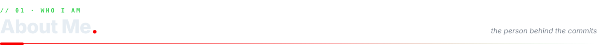

<!-- Identity card, stats and live "now shipping" (scripts/build_about_hero.py) -->

  <a href="https://github.com/AbdullahBakir97">
    
  </a>

<!-- about.py: the short version in code, with a rotating motto in the output -->

  

<!-- 💭 QUOTE OF THE DAY — auto-rotates daily by day-of-year -->
<!-- QUOTE:START -->

  <i>"The most damaging phrase in the language is: 'We've always done it this way!'"</i> 
  — <b>Grace Hopper</b>

<!-- QUOTE:END -->

<!-- TABLE OF CONTENTS — cards generated from the section list in scripts/build_section_headers.py -->

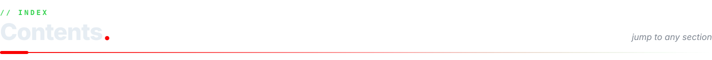

  <a href="#about">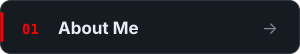</a>
  <a href="#skills">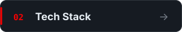</a>
  <a href="#focus">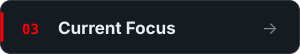</a>
  <a href="#highlights">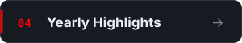</a>
  <a href="#stats">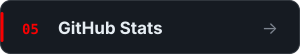</a>
  <a href="#activity">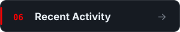</a>
  <a href="#releases">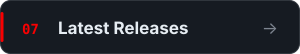</a>
  <a href="#projects">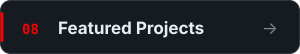</a>
  <a href="#pagespeed">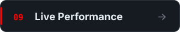</a>
  <a href="#contributions">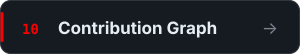</a>
  
  <a href="#guestbook">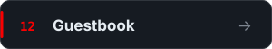</a>

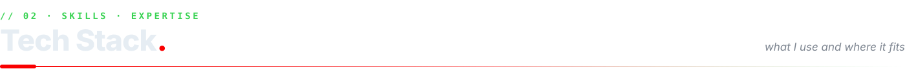

<!-- Request flow — one request through the whole stack (animated SVG) -->

  

<b>See the full stack</b>: <code>pip install abdullah-bakir</code> (62 packages)

 

  

 

<!-- 💎 Elite tech stack cards — single SVG, 6 glassmorphism cards in 3×2 grid
     with accent stripes, stats, and animated proficiency bars (Vercel/Linear aesthetic) -->

  

<!-- 🧠 NEURAL SKILL ATLAS
     ──────────────────────────────────────────────────────────────────────
     The brain SVG below is built from Wikimedia Commons' anatomically-
     accurate "Human-brain.SVG" by Hugh Guiney (CC-BY-SA-3.0), recolored
     with our neon palette via scripts/build_anatomical_brain.py.

     Regenerate (e.g., to tweak colors) with:
        python scripts/build_anatomical_brain.py
     ────────────────────────────────────────────────────────────────────── -->

<h3 align="center">Neural Skill Atlas</h3>

<i>How my skills connect. You can open it in 3D.</i>

  

  
  &nbsp;
  

<b>More skills</b>: paradigms · operating systems · async · UI frameworks · data science · IDEs · APIs &amp; security

 

<table align="center" width="100%">
<tr>
<td align="center" width="33%" valign="top"><h4>Paradigms &amp; Architecture</h4>
     
</td>
<td align="center" width="33%" valign="top"><h4>Operating Systems &amp; Shells</h4>
    
</td>
<td align="center" width="33%" valign="top"><h4>Async &amp; Messaging</h4>
   
</td>
</tr>
<tr>
<td align="center" width="33%" valign="top"><h4>UI Frameworks</h4>
    
</td>
<td align="center" width="33%" valign="top"><h4>Data Science</h4>
    
</td>
<td align="center" width="33%" valign="top"><h4>IDEs &amp; Notebooks</h4>
   
</td>
</tr>
<tr>
<td align="center" width="33%" valign="top"><h4>APIs &amp; Security</h4>
    
</td>
<td align="center" width="33%" valign="top"><h4>Design &amp; Docs</h4>
  
</td>
<td align="center" width="33%" valign="top"><h4>Languages</h4>
  
</td>
</tr>
<tr>
<td align="center" width="33%" valign="top"><h4>Backend Runtimes</h4>
 
</td>
<td align="center" width="33%" valign="top"><h4>Databases</h4>
    
</td>
<td align="center" width="33%" valign="top"><h4>Cloud Native</h4>
  
</td>
</tr>
</table>

<!-- CURRENT FOCUS — six busiest repos of the last 30 days, rebuilt by readme.yml (scripts/build_current_focus.py) -->

  

<!-- YEARLY HIGHLIGHTS -->

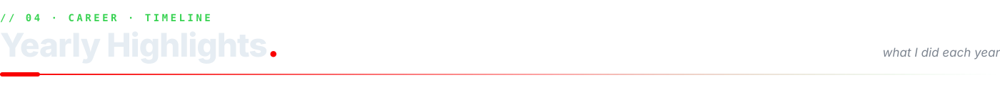

  

<!-- 📊 Live stats — auto-refreshed daily from GitHub GraphQL by readme.yml -->

<b>This year, live from GitHub</b>

<!-- HIGHLIGHTS_STATS:START -->

   

<!-- HIGHLIGHTS_STATS:END -->

<!-- The narrative bullets are still updated separately by you — kept as a marker
     so the text stays editable without rebuilding the SVG. -->
<!-- HIGHLIGHTS_CURRENT_YEAR:START -->
<!-- (Narrative for the current year is rendered inside yearly-highlights.svg) -->
<!-- HIGHLIGHTS_CURRENT_YEAR:END -->

<!-- GITHUB STATS — self-hosted cards rebuilt daily by readme.yml (no third-party card services) -->

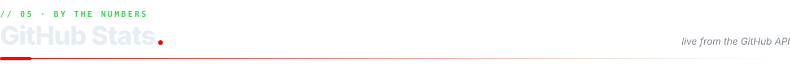

  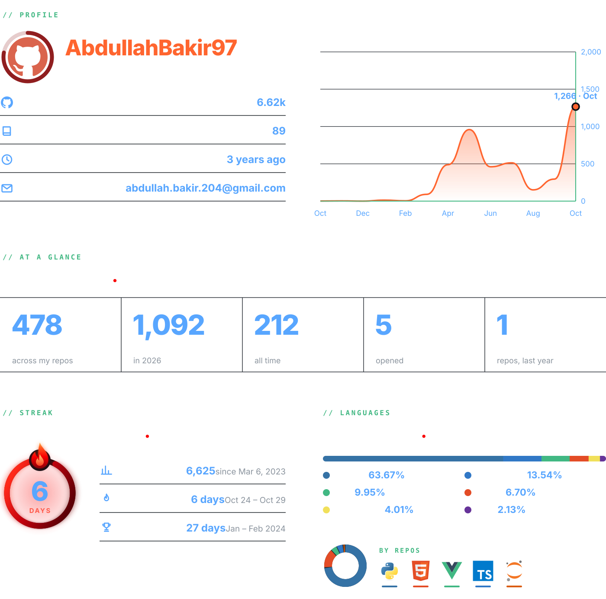

<!--START_OF_CODE_STATS-->

<!--END_OF_CODE_STATS-->

<!-- RECENT ACTIVITY -->

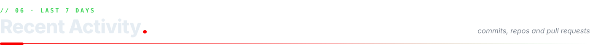

  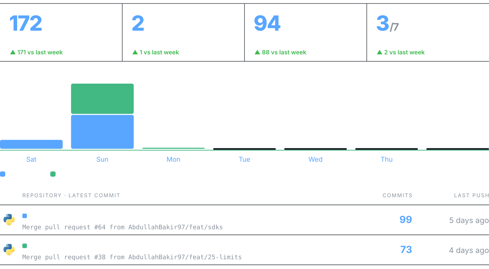

<!-- LATEST RELEASES -->

  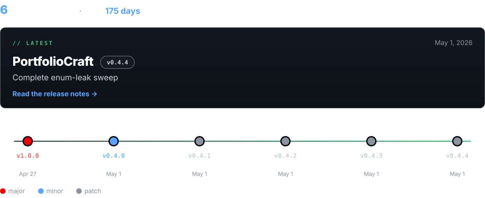

<!-- FEATURED PROJECTS — spotlight copy lives in .github/scripts/spotlight.json; numbers, cards and index are rebuilt by readme.yml -->

<h3 align="center">Spotlight</h3>

  <a href="https://github.com/AbdullahBakir97/Mini-RAG">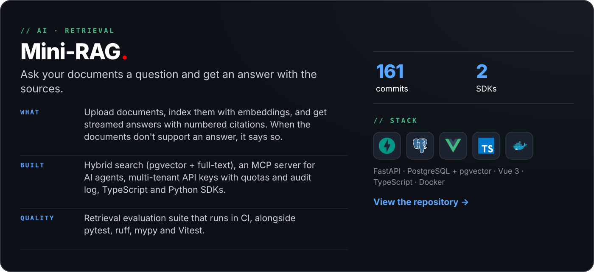</a>

  <a href="https://github.com/AbdullahBakir97/Django--LMS--Learning-Management-System">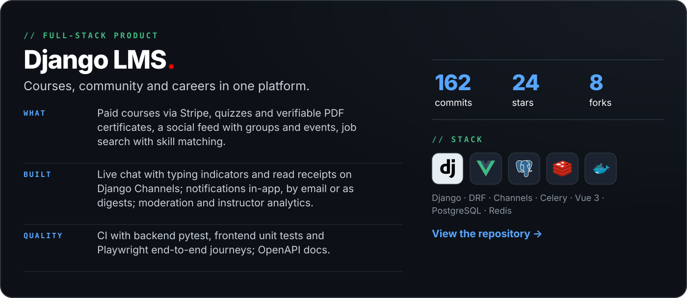</a>

  <a href="https://github.com/AbdullahBakir97/DevTrust">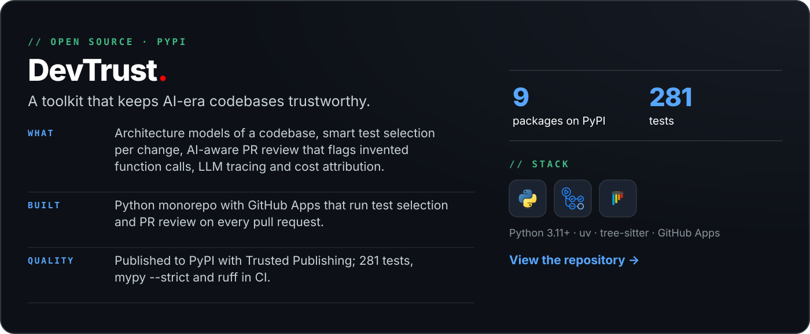</a>

<h3 align="center">Featured</h3>

<!-- FEATURED_PROJECTS:START -->

  <a href="https://github.com/AbdullahBakir97/Barber-Salon">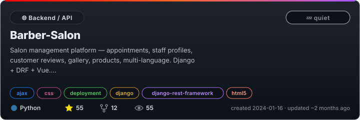</a>
  <a href="https://github.com/AbdullahBakir97/Baeckrei">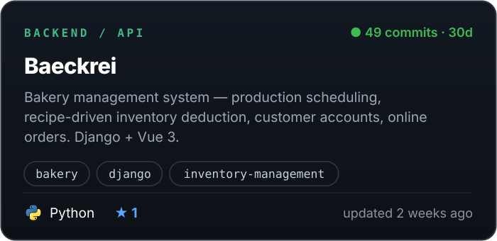</a>

  <a href="https://github.com/AbdullahBakir97/Jobs-Portal">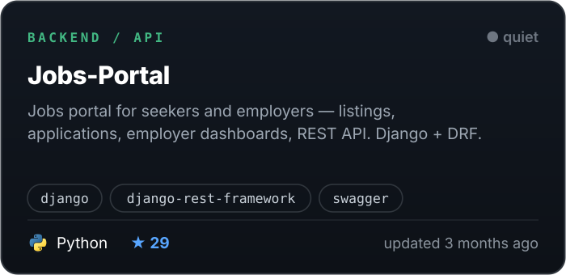</a>
  <a href="https://github.com/AbdullahBakir97/Django-Store">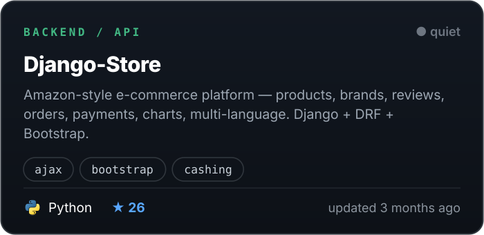</a>

  <a href="https://github.com/AbdullahBakir97/PortfolioCraft">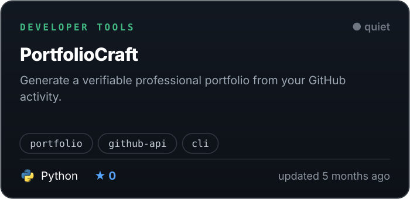</a>
  <a href="https://github.com/AbdullahBakir97/Django-Blog-app">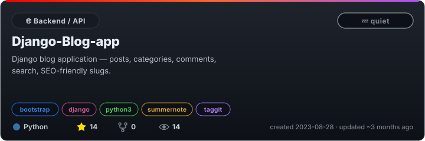</a>

<!-- FEATURED_PROJECTS:END -->

<b>Project index</b>: every other repository, grouped by area

 

<!-- PINNED_REPOS:START -->
<table width="100%">
<tr><th align="left" colspan="2">Developer tools · 10</th></tr>
<tr><td><a href="https://github.com/AbdullahBakir97/ai-quality-gate"><b>ai-quality-gate</b></a></td><td>GitHub App that runs an AI-driven quality gate on</td></tr>
<tr><td><a href="https://github.com/AbdullahBakir97/API-Client-Generator"><b>API-Client-Generator</b></a></td><td>Generate typed Python API clients from OpenAPI specs</td></tr>
<tr><td><a href="https://github.com/AbdullahBakir97/commit-craft"><b>commit-craft</b></a></td><td>GitHub App that auto-formats pull-request commits to</td></tr>
<tr><td><a href="https://github.com/AbdullahBakir97/GitHub-Doc-Generator"><b>GitHub-Doc-Generator</b></a></td><td>Auto-generate documentation pages from a GitHub</td></tr>
<tr><td><a href="https://github.com/AbdullahBakir97/issue-triage-bot"><b>issue-triage-bot</b></a></td><td>GitHub App that auto-labels and routes new issues</td></tr>
<tr><td><a href="https://github.com/AbdullahBakir97/pr-coach"><b>pr-coach</b></a></td><td>GitHub App that coaches authors during pull-request</td></tr>
<tr><td><a href="https://github.com/AbdullahBakir97/Python-Environment-Management-Tool"><b>Python-Environment-Management-Tool</b></a></td><td>CLI to manage Python virtualenvs and project</td></tr>
<tr><td><a href="https://github.com/AbdullahBakir97/release-pilot"><b>release-pilot</b></a></td><td>GitHub App that drafts release notes and version</td></tr>
<tr><td><a href="https://github.com/AbdullahBakir97/Repo-Directory-Structure"><b>Repo-Directory-Structure</b></a></td><td>Generate a tree-style snapshot of any repository&#x27;s</td></tr>
<tr><td><a href="https://github.com/AbdullahBakir97/repodoc-ai"><b>repodoc-ai</b></a></td><td>GitHub App that auto-generates and refreshes README</td></tr>
<tr><th align="left" colspan="2">AI · Data · 2</th></tr>
<tr><td><a href="https://github.com/AbdullahBakir97/AI-KI"><b>AI-KI</b></a></td><td>Notebook-driven AI experiments</td></tr>
<tr><td><a href="https://github.com/AbdullahBakir97/cortex"><b>cortex</b></a></td><td>Memory-augmented agent kernel</td></tr>
<tr><th align="left" colspan="2">Backend / API · 17</th></tr>
<tr><td><a href="https://github.com/AbdullahBakir97/ai-approve"><b>ai-approve</b></a></td><td>GitHub App + autonomous code-review bot</td></tr>
<tr><td><a href="https://github.com/AbdullahBakir97/API"><b>API</b></a></td><td>Django REST Framework reference API</td></tr>
<tr><td><a href="https://github.com/AbdullahBakir97/Automtion"><b>Automtion</b></a></td><td>Browser-automation playground</td></tr>
<tr><td><a href="https://github.com/AbdullahBakir97/Content-Creator-Tool"><b>Content-Creator-Tool</b></a></td><td>Content creation utility</td></tr>
<tr><td><a href="https://github.com/AbdullahBakir97/Dj--To-Do"><b>Dj--To-Do</b></a></td><td>Django to-do app</td></tr>
<tr><td><a href="https://github.com/AbdullahBakir97/Django-Followers-System"><b>Django-Followers-System</b></a></td><td>Reusable followers/following app for Django</td></tr>
<tr><td><a href="https://github.com/AbdullahBakir97/Django-Reporting-System"><b>Django-Reporting-System</b></a></td><td>Reporting dashboard for Django apps</td></tr>
<tr><td><a href="https://github.com/AbdullahBakir97/e-pay_tool"><b>e-pay_tool</b></a></td><td>—</td></tr>
<tr><td><a href="https://github.com/AbdullahBakir97/Email-Sender"><b>Email-Sender</b></a></td><td>Bulk email sender</td></tr>
<tr><td><a href="https://github.com/AbdullahBakir97/GitHub-Issues-Wall"><b>GitHub-Issues-Wall</b></a></td><td>Browser wall of GitHub issues</td></tr>
<tr><td><a href="https://github.com/AbdullahBakir97/image-cropping"><b>image-cropping</b></a></td><td>Server-side image cropping utility</td></tr>
<tr><td><a href="https://github.com/AbdullahBakir97/Pilot-Logbook"><b>Pilot-Logbook</b></a></td><td>Pilot logbook</td></tr>
<tr><td><a href="https://github.com/AbdullahBakir97/Project-Management-Tool"><b>Project-Management-Tool</b></a></td><td>Project management tool</td></tr>
<tr><td><a href="https://github.com/AbdullahBakir97/Py-Desktop-Expense_Tracker"><b>Py-Desktop-Expense_Tracker</b></a></td><td>Desktop expense tracker</td></tr>
<tr><td><a href="https://github.com/AbdullahBakir97/Python-Django-join_with"><b>Python-Django-join_with</b></a></td><td>Django QuerySet join examples</td></tr>
<tr><td><a href="https://github.com/AbdullahBakir97/Stock-Manager"><b>Stock-Manager</b></a></td><td>Professional desktop inventory management for</td></tr>
<tr><td><a href="https://github.com/AbdullahBakir97/Trello-Clone-Services"><b>Trello-Clone-Services</b></a></td><td>Trello-style kanban backend</td></tr>
<tr><th align="left" colspan="2">Frontend · 4</th></tr>
<tr><td><a href="https://github.com/AbdullahBakir97/2050-Bootstrap-Landing-page"><b>2050-Bootstrap-Landing-page</b></a></td><td>Marketing landing page demo built with Bootstrap 5</td></tr>
<tr><td><a href="https://github.com/AbdullahBakir97/Portfolio"><b>Portfolio</b></a></td><td>Personal portfolio site</td></tr>
<tr><td><a href="https://github.com/AbdullahBakir97/Tawil-Media---Advertisement"><b>Tawil-Media---Advertisement</b></a></td><td>Marketing site for Tawil Media</td></tr>
<tr><td><a href="https://github.com/AbdullahBakir97/Weather--App-django-vue.js"><b>Weather--App-django-vue.js</b></a></td><td>Weather lookup app</td></tr>
<tr><th align="left" colspan="2">Games · 2</th></tr>
<tr><td><a href="https://github.com/AbdullahBakir97/Py-Tetris-Game"><b>Py-Tetris-Game</b></a></td><td>Tetris implementation in Python with pygame</td></tr>
<tr><td><a href="https://github.com/AbdullahBakir97/Space-Shooter"><b>Space-Shooter</b></a></td><td>Space shooter mini-game</td></tr>
</table>
<!-- PINNED_REPOS:END -->

<!-- LIVE PERFORMANCE — Lighthouse scores for kharsa-style.de, rebuilt daily by readme.yml -->

<!-- PAGESPEED:START -->
<!-- PAGESPEED:END -->

<!-- CONTRIBUTION GRAPH -->

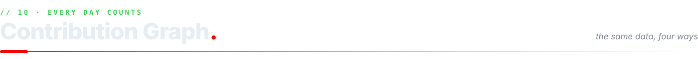

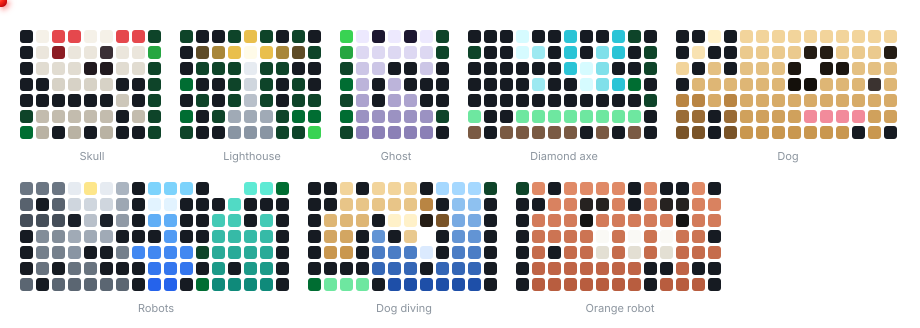

I found eight shapes in my contribution graph. Every square is a real day and I didn't draw anything.

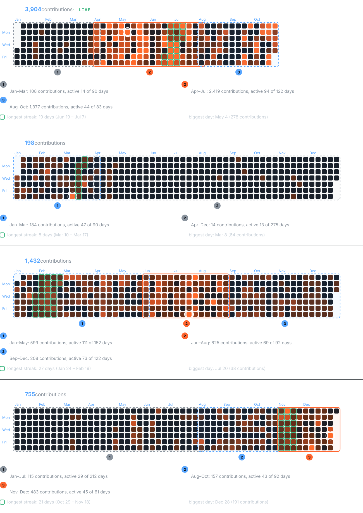

<!-- CONTRIB_LINKS:START -->

<b>The same data in 3D:</b> <a href="./profile-3d-contrib/profile-night-rainbow.svg">3D profile</a> · skyline models <a href="https://github.com/AbdullahBakir97/AbdullahBakir97/blob/metrics-output/skyline-2023.stl">2023</a> · <a href="https://github.com/AbdullahBakir97/AbdullahBakir97/blob/metrics-output/skyline-2024.stl">2024</a> · <a href="https://github.com/AbdullahBakir97/AbdullahBakir97/blob/metrics-output/skyline-2025.stl">2025</a> · <a href="https://github.com/AbdullahBakir97/AbdullahBakir97/blob/metrics-output/skyline-2026.stl">2026</a> · cities <a href="https://honzaap.github.io/GithubCity?name=AbdullahBakir97&year=2023">2023</a> · <a href="https://honzaap.github.io/GithubCity?name=AbdullahBakir97&year=2024">2024</a> · <a href="https://honzaap.github.io/GithubCity?name=AbdullahBakir97&year=2025">2025</a> · <a href="https://honzaap.github.io/GithubCity?name=AbdullahBakir97&year=2026">2026</a>

<!-- CONTRIB_LINKS:END -->

<!-- CONNECT WITH ME -->

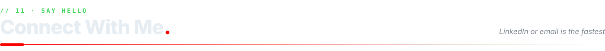

  <a href="https://www.linkedin.com/in/abdullah-bakir-809065273/">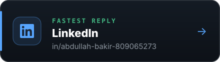</a>
  <a href="mailto:abdullah.bakir.204@gmail.com">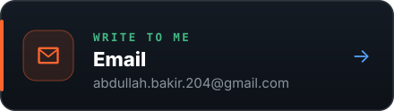</a>

  <a href="https://github.com/AbdullahBakir97">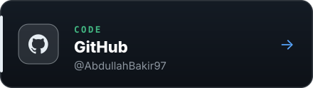</a>
  <a href="https://t.me/BlackSea0011">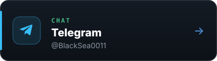</a>

<!-- GUESTBOOK — visitors leave a message via a pre-filled issue template -->

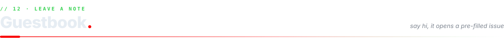

  <a href="https://github.com/AbdullahBakir97/AbdullahBakir97/issues/new?template=guestbook.yml">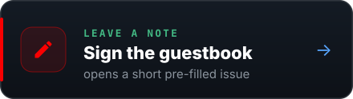</a>
  <a href="https://github.com/AbdullahBakir97/AbdullahBakir97/issues?q=label%3Aguestbook">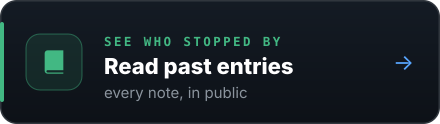</a>

  <a href="https://www.buymeacoffee.com/abdullahbad">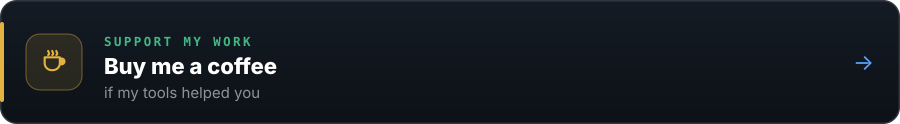</a>

<a href="#about">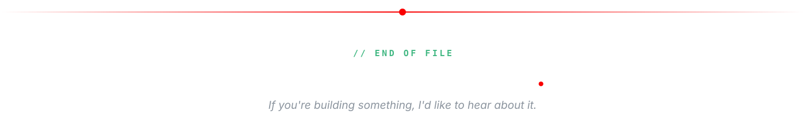</a>

